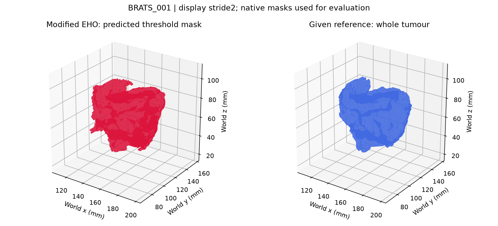

# EHO MRI Research Paper

Research code, manuscript drafts and reproducible experiments comparing Elephant
Herding Optimisation with classical optimisers, followed by MRI enhancement,
exploratory tumour segmentation and physical-coordinate 3D visualisation.

**The executable pipeline covers every declared stage. Historical MRI code was
not fully recovered:** the enhancement, segmentation and full-volume surface
stages are explicitly documented new implementations derived from the draft's
concepts. Their results cannot authenticate the original manuscript figures.

Authors: **Pushkar Tuse** and **Nitya Mohta**.

## Independent MS lesion validation — 11 October 2026

The frozen reconstructed pipeline was evaluated on **115 FLAIR scans from 75
MSLesSeg patients**, five optimisers with three seeds and direct Otsu, followed by
component ablations, controlled registration/noise studies and independent
saved-output verification. These expert annotations are **multiple-sclerosis
lesions, not tumours**. The external results are preserved separately from BraTS.

Mean lesion Dice is **0.0289** for modified EHO and **0.0348** for direct Otsu;
modified-EHO precision is about **1.5%**. Controlled registration and noise studies
also expose limitations. These results do not support broad lesion accuracy,
registration-superiority or denoising claims. **127 canonical tests and 155,498
independent output checks passed**, establishing consistency rather than clinical
accuracy.

- [Complete comparison report](results/external_mslesseg_20261011/reports/COMPLETE_EXTERNAL_VALIDATION.md)
- [Dataset access and suitability ranking](reports/external_dataset_access_20261011.md)
- [External code and reproduction commands](EXTERNAL_VALIDATION_README.md)
- [Download every prediction, mesh and 115 interactive viewers](https://github.com/PushkarTuse/EHO_MRI_research_paper_/releases/tag/external-mslesseg-2026-10-11)
- [Release extraction and provenance instructions](reports/EXTERNAL_PUBLICATION.md)

Download and extract all release ZIPs into this clone, then open
`results/external_mslesseg_20261011/reports/VIEW_EXTERNAL_RESULTS.html`. GitHub
displays HTML source; these self-contained viewers run in a local browser.
All 115 viewer links resolve once the complete release is extracted. The raw
official dataset is obtained separately with the attributed, checksum-verified
downloader.

## Read or view the results

- [Code completeness and provenance](reports/CODE_COMPLETENESS.md)
- [Results compared with manuscript claims](results/run_20261005/reports/CLAIMS_VS_RERUNS.md)
- [Claim-to-evidence CSV](results/run_20261005/reports/claim_comparison.csv)
- [PDF code coverage: 145 pages](reports/pdf_code_coverage.md)
- [Executed commands and stage ledger](results/run_20261005/stage_ledger.json)
- [Saved-output validation](results/run_20261005/reports/validation.json)
- [Original manuscript PDF](manuscripts/without_citations_draft.pdf)
- [Rewritten manuscript DOCX](manuscripts/without_citations_draft_rewritten.docx)
- [Abstract](manuscripts/abstract.txt)
- [Final reference screen recording, 61 seconds](media/interactive_prediction_reference_brats001_2026-10-11.mp4)

After cloning or downloading the repository, open **[VIEW_RESULTS.html](VIEW_RESULTS.html)**
in a browser to play the recording and open the interactive models. GitHub's normal
file view displays HTML source; run the viewers locally to interact with them.



| Case | Interactive viewer | Modified EHO mean Dice | Direct Otsu Dice |
|---|---|---:|---:|
| BRATS_001 | [Open model](results/run_20261005/imaging/BRATS_001/meshes/interactive_prediction_reference.html) | 0.8675 | 0.8707 |
| BRATS_002 | [Open model](results/run_20261005/imaging/BRATS_002/meshes/interactive_prediction_reference.html) | 0.4305 | 0.4651 |
| BRATS_003 | [Open model](results/run_20261005/imaging/BRATS_003/meshes/interactive_prediction_reference.html) | 0.9120 | 0.9208 |

## What the saved run establishes

The original execution passed **72 unit tests** and **552 saved-output checks**.
The organized publication copy passed **90 tests** (including portability
regressions) and all **552 saved-output checks** again. The final packaging audit
confirmed that **761 historical measurement CSV/JSON files** match their original
bytes; see [publication validation](reports/PUBLICATION_VALIDATION.json).
All 484 listed training image/label pairs were inventoried; quantitative MRI
evaluation covered **three full volumes**, three seeds per stochastic method,
and a deterministic Otsu baseline. Seed variation and patient variation are
reported separately. No learned model was trained or benchmarked.

The reconstructed modified-EHO pipeline has mean whole-tumour Dice **0.737**,
compared with **0.752** for direct Otsu on this subset. It does not establish a
general accuracy advantage. Modified EHO also performs poorly on the prespecified
shifted-function and anatomical rigid-perturbation experiments. These outcomes,
historical route-feasibility defects, and constant-only MRI charts are retained
in the reports rather than replaced by favourable numbers.

Predictions are saved before reference labels are opened. Reference surfaces are
identified as given annotations, separately from predictions. PSNR/SSIM against
the input measure appearance similarity, rather than denoising accuracy. Native
masks determine overlap metrics; stride2 is used only for displayed meshes.

## Repository layout

```text
manuscripts/   original PDF, rewritten DOCX and abstract
src/           documented runners, optimisers, imaging and audit utilities
tests/         synthetic correctness and accounting checks
sources/       preserved notebooks/cells/snippets, code PDFs and extraction maps
reports/       method notes, completeness, coverage and publication provenance
results/       original replay, mesh audit and the complete 2026-10-05 measured run
media/         requested screen recording and integrity metadata
data/          dataset instructions and metadata; raw dataset obtained separately
run_all.py     sequential pipeline entry point
VIEW_RESULTS.html  local results and video navigation
```

The commented review DOCX, raw dataset, installed Python environment, caches and
duplicate extracted ZIP folder are excluded. The original and rewritten
manuscripts are preserved as drafts; later rerun findings should guide revisions.

## Set up and run

Use Python **3.12**. From the repository root:

```powershell
py -3.12 -m venv .venv
& '.\.venv\Scripts\python.exe' -m pip install -r requirements-lock.txt
& '.\.venv\Scripts\python.exe' -m pytest tests -q
```

See [dataset instructions](data/README.md) for Task01_BrainTumour. Provide its
directory explicitly, or set `EHO_DATASET_PATH`:

```powershell
& '.\.venv\Scripts\python.exe' -u run_all.py --dataset 'D:\MInor Project\datasets\New folder\Task01_BrainTumour' --output results/new_run_20261011
```

Equivalent commands on Linux/macOS use `python3.12`, `.venv/bin/python` and a
local dataset path. CPU stages run sequentially with one BLAS thread. No GPU or
neural-network checkpoint is required.

To run only MRI processing on a chosen cohort:

```powershell
& '.\.venv\Scripts\python.exe' -u run_all.py --dataset 'YOUR_DATASET_DIRECTORY' --output results/new_run_mri --stages imaging --cases 3
```

To verify the published saved outputs against a locally available dataset:

```powershell
& '.\.venv\Scripts\python.exe' src/validate_outputs.py --run results/run_20261005 --dataset 'YOUR_DATASET_DIRECTORY'
```

Historical logs and saved JSON/CSV records retain their original machine paths
and timestamps as provenance. Repository utilities resolve those paths to the
current clone; new executions record their own environment and configuration.

## Methods and data attribution

- [Routing methods and original defects](reports/routing_method_notes.md)
- [Continuous optimisation, registration and ablations](reports/source_method_notes.md)
- [MRI implementation and evaluation](reports/imaging_method_notes.md)
- [Preserved historical STL files](sources/existing_meshes/README.md)
- [Publication packaging notes](reports/PUBLICATION_NOTES.md)

The local dataset is Medical Segmentation Decathlon **Task01_BrainTumour**, based
on BraTS, release2.0. Its metadata declares **CC-BY-SA4.0** and identifies the
BraTS2017 reference. Dataset-derived masks, enhanced volumes and meshes are
attributed in [DATA_ATTRIBUTION.md](DATA_ATTRIBUTION.md). No new licence for the
authors' original code or manuscripts is assigned by this packaging step.
